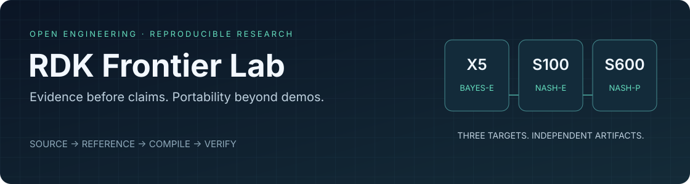

<p align="center"></p>

# RDK Frontier Lab

**An evidence-first algorithm portability lab for RDK X5, S100 and S600.**

[](https://github.com/Xiaomiju-x/rdk-frontier-lab/actions/workflows/ci.yml)
[](LICENSE)
[](pyproject.toml)

[简体中文](README.zh-CN.md) · [Start in two minutes](docs/quickstart.md) · [Algorithm catalogue](docs/catalogue.md) · [Results & limits](docs/results.md) · [Contribute](CONTRIBUTING.md)

We investigate how algorithms from the wider open-source ecosystem translate to
RDK hardware: what exports, what compiles, what actually runs, and what remains
numerically faithful. Successful runs **and failed migrations** are first-class
results. A fast but inaccurate model is not a successful deployment.

This is a community-maintained project by [Xiaomiju-x](https://github.com/Xiaomiju-x),
not an official D-Robotics product or a vendor certification programme.

## What you get today

| Available in this repository | Deliberately not claimed |
| --- | --- |
| Dependency-free Python CLI and evidence contracts | An automatic model downloader or remote device manager |
| Hash-checked fixtures, strict JSON, numerical metrics and independent-target comparison | Cryptographic attestation that a contributor really ran hardware |
| Runnable CPU arithmetic demo and optional weighted-Kabsch geometry recipe | A demo standing in for a trained foundation model |
| Dated catalogue, source pins, asset-review notes and selected failure studies | Every catalogue entry being a bundled or working BPU model |
| Tests, packaging, release checks, contribution and security policies | Production readiness, real-world accuracy or robot-control approval |

**Release scope: alpha tooling + a historical research snapshot.** The catalogue
records intended targets separately from observed status. Some entries overlap;
counting entries is not counting unique models, successful deployments or BPU cores.
See [the publication boundary](docs/publication.md) before reusing a result.

## Try it — no board, account, GPU or download required

After cloning, run from the repository root with Python 3.10 or newer:

```bash
python -m rdk_lab doctor
python -m rdk_lab demo
python -m rdk_lab catalog --target s600
```

The demo prints `DEMO_PASS`, not `BPU_PASS`. It checks six scalar values and rejects
non-finite input. It does not train a model, inspect devices or contact the network.

To install the CLI in your own environment:

```bash
python -m pip install .
rdk-lab --version
rdk-lab catalog --group frontier --json
```

`pip install .` may fetch build tooling; the installed core has **zero runtime
dependencies**. This project is not yet published to PyPI: do not assume that a
similarly named index package is ours. See [offline installation](docs/quickstart.md).

## One workflow, three independent targets

```text
Pinned source + licensed assets + immutable evaluation contract
                         │
                  Host reference
                         │
         ┌───────────────┼───────────────┐
         ▼               ▼               ▼
    X5 / Bayes-e    S100 / Nash-e   S600 / Nash-p
       .bin             .hbm            .hbm
         └───────────────┼───────────────┘
                         ▼
     Same-input numerics + task gate + comparable timing
                         ▼
            Clean exit + reviewed evidence
```

S100 and S600 HBM files are **not interchangeable**. Target, compiler, source,
configuration, calibration and evaluation identities belong in every migration.
CPU, BPU and hybrid results remain separate.

## Research snapshot · 2026-09-03

- **Official examples:** real X5/S100 BPU or hybrid observations span detection,
  tracking, OCR, prompt segmentation, optical flow, depth, speech and point clouds.
  Most establish bounded offline execution, not labelled-dataset accuracy.
- **S600 platform:** independent compiler/runtime canaries, multi-core studies,
  a 30-minute mixed-model run and SSH-disconnect recovery have recorded results.
- **Complete-model CPU baselines:** SigLIP2's complete vision tower with cached
  text embeddings and SwinIR-S ×2 have accepted S600 CPU observations.
- **Hard problems remain:** D-FINE, RTMPose, EfficientAD, SwinIR and other new
  BPU routes include numerical failures. TTM R3's native CPU deployment remains
  unfinished; two official ONNX export routes failed.

These are **maintainer-reported historical observations**, not fresh runs performed
by this release or fully independently reproducible public benchmarks. Raw private
receipts, weights and original datasets are not bundled. Selected projections have
original-file digests, explicit scope and verification limits in [results](docs/results.md).

### Learn from a failure: SwinIR quantization

The default S600 route executed quickly but exceeded its frozen image-quality
error budget. A single precision-first candidate substantially reduced the error,
yet still missed the same **0.30 dB** PSNR-drop limit. It was stopped before a new
board run. We retain the failure rather than changing the limit after seeing it.

[Read the case study →](docs/case-studies/swinir-quantization.md)

## Repository map

| Path | Purpose |
| --- | --- |
| [`rdk_lab/`](rdk_lab/) | Portable CLI, contracts, integrity and numerical tools |
| [`examples/`](examples/) | Safe, small and explicitly labelled offline examples |
| [`recipes/`](recipes/) | Reviewed first-party algorithm source and reuse boundaries |
| [`registry/`](registry/) | Source pins, asset notes and snapshot provenance |
| [`reports/`](reports/) | Sanitized observations, never raw internal logs |
| [`schemas/`](schemas/) | Versioned public data interfaces |
| [`docs/`](docs/) | Architecture, targets, reproducibility, limitations and failure studies |
| [`tests/`](tests/) | Offline correctness and hostile-input regression tests |
| [`tools/`](tools/) | Publication audit, generated documentation and packaging checks |

## Contribute an algorithm, not just a model name

Start with the [contributor guide](CONTRIBUTING.md) and [model-entry template](templates/model-entry.md).
Bring an exact upstream revision, separate code/weight/data terms, a real model
identity, independent calibration and held-out inputs, and an honest execution
boundary. A well-documented incompatibility or failed numerical gate is useful.

No model loading, compilation, telemetry upload, hardware access or robot command
happens automatically in the public tooling or hosted CI. Device execution belongs
in a separately reviewed environment; see [hardware boundaries](docs/hardware.md).

## Maintenance and reuse

[Roadmap](ROADMAP.md) · [Changelog](CHANGELOG.md) · [Governance](GOVERNANCE.md) ·
[Security](SECURITY.md) · [Support](SUPPORT.md) · [Citation](CITATION.cff)

First-party core code is Apache-2.0. The identified geometry components retain
their MIT grant. The scalar fixture is CC0-1.0. Upstream code, checkpoints, datasets
and vendor runtimes keep their own terms; this repository does not relicense them.
See [NOTICE](NOTICE) and [third-party notices](THIRD_PARTY_NOTICES.md).
