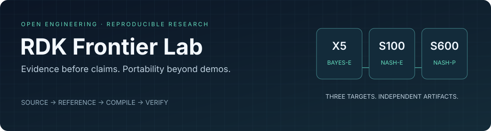

<p align="center"></p>

# RDK 前沿算法生态实验室

**面向 RDK X5、S100、S600 的可复现算法迁移、验证与工程实践。**

[English](README.md) · [快速开始](docs/quickstart.md) · [算法台账](docs/catalogue.md) · [结果与边界](docs/results.md) · [参与贡献](CONTRIBUTING.md)

我们关注的不只是“模型能不能启动”，而是：源码和资产是否明确、能否导出、能否独立编译、是否真的在目标后端执行、量化后是否保持原有语义，以及别人能否复现。

项目由 [Xiaomiju-x](https://github.com/Xiaomiju-x) 维护，是社区研究与工程项目，**不是地瓜官方产品、认证或质量保证**。

## 首版提供什么

- 零运行时依赖的 Python 工具包：严格 JSON、文件哈希与路径验证、数值比较、验收回执检查、三板结果对比。
- 不需要开发板、账号、GPU 或模型下载的离线示例；另有可选 NumPy 加权 Kabsch 几何算法。
- 按时间记录的官方样例、前沿模型和预研台账，明确区分完整模型、子图、替代方案、CPU 和 BPU。
- 脱敏历史结果与失败案例、双语入口、测试、发布检查、贡献模板及维护规范。

**当前是 alpha 工具包与研究快照，不是全部算法已经部署成功的成品模型库。** 台账中存在组合条目和交叉引用；条目数不等于独立模型数，更不等于三板成功数。

## 两分钟开始

克隆仓库后，在根目录使用 Python 3.10 或更新版本：

```bash
python -m rdk_lab doctor
python -m rdk_lab demo
python -m rdk_lab catalog --target s600
```

示例只对六个数执行确定性运算并检查异常输入，输出 `DEMO_PASS`。它不训练模型、不访问设备、不联网，也不会把结果写成 `BPU_PASS`。

如需安装命令行工具：

```bash
python -m pip install .
rdk-lab --version
rdk-lab catalog --group frontier --json
```

安装时可能下载构建工具；核心运行时没有第三方依赖。**本项目尚未发布到 PyPI**，不要仅凭包名安装索引中的同名包。完全离线的使用方法见[快速开始](docs/quickstart.md)。

## 三板独立，证据一致

| 目标 | 编译目标 | 制品 | 边界 |
| --- | --- | --- | --- |
| X5 | `bayes-e` | `.bin` | 独立图、配置、校准与实板证据 |
| S100 | `nash-e` | `.hbm` | 不复用 S600 HBM |
| S600 | `nash-p` | `.hbm` | 独立 HBM，多核结果另行记录 |

共同流程是：来源锁定 → 主机参考 → 独立编译 → 同输入数值与任务验证 → 可比性能 → 洁净退出 → 证据审核。编译成功、CPU 成功、运行器测试成功都不自动等于 BPU 成功。

## 截至 2026-09-03 的实际研究状态

- **官方复现已有实板记录**：X5/S100 涵盖检测、跟踪、OCR、SAM、光流、双目、语音、点云、姿态和分割等方向。多数是固定离线样例的功能验证，不能扩张为公开数据集精度。
- **S600 平台底座已验证多项能力**：独立编译与运行时 canary、多核研究、30 分钟异模型稳态和 SSH 断连恢复；这些不代表所有重模型都已通过。
- **完整模型 CPU 基线**：SigLIP2 完整视觉塔配合缓存文本向量，以及 SwinIR-S ×2，已有 S600 CPU 验收记录。不是实时完整双塔服务。
- **前沿 BPU 迁移仍有失败**：D-FINE、RTMPose、EfficientAD、SwinIR 等相应路线未过数值门。TTM R3 的两条官方 ONNX 导出路线失败，原生 CPU 部署尚未完成。

这里是**维护者基于历史机器记录整理的观察**。首版未附原始私有日志、原始测试数据与模型权重，不能把公开摘要当成第三方已经独立复现。公开摘要保留原文件摘要值和未验证边界，详见[结果报告](docs/results.md)。

## 失败同样有价值

SwinIR 默认 S600 BPU 路线很快，但图像质量误差超出原门。唯一精度优先候选将误差显著减小，仍没有达到冻结的 **0.30 dB** PSNR 下降门槛，因此停止这条路线，不投放新制品、不事后降低门。

[阅读 SwinIR 量化案例](docs/case-studies/swinir-quantization.md) · [RTMPose 同输入逐阶段定位](docs/case-studies/rtmpose-quantization.md)

## 如何长期维护

贡献需要带来清晰身份、固定来源、可复现输入、独立后端和验收边界，不以换格式、提示词、种子或一个源码子图扩充“完整模型数量”。欢迎完整迁移，也欢迎可复现的失败案例。

- [贡献流程](CONTRIBUTING.md)、[算法提交模板](templates/model-entry.md)、[维护治理](GOVERNANCE.md)
- [路线图](ROADMAP.md)、[已知限制](docs/limitations.md)、[接口版本](docs/api.md)
- [发布边界](docs/publication.md)、[安全报告](SECURITY.md)、[许可说明](THIRD_PARTY_NOTICES.md)

首版工具与 CI 不自动下载模型、不连接开发板、不触发训练/编译，也不控制机器人。真实设备运行必须使用独立审核的环境；详细边界见[硬件说明](docs/hardware.md)。

核心代码 Apache-2.0，指定几何组件保留 MIT，六数示例数据 CC0-1.0。上游权重、数据与厂商工具链保留各自许可，不因本项目开源而获得重新授权。
